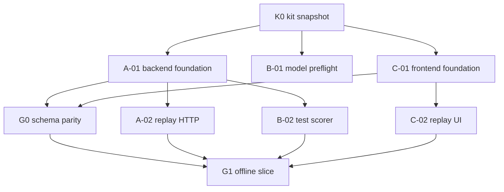
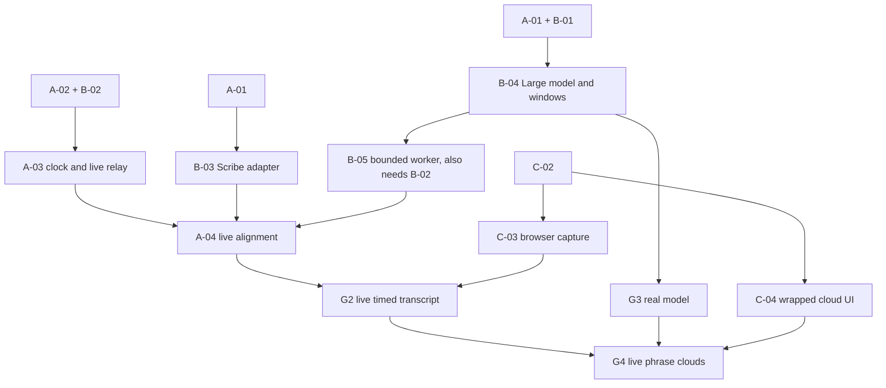
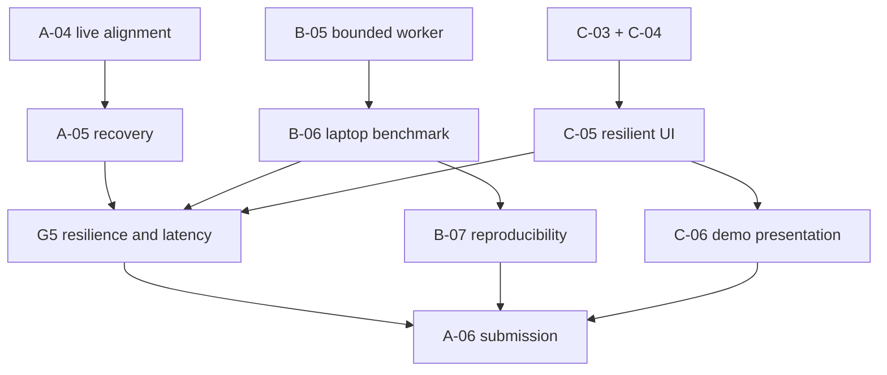

# Dependencies and parallel work

K0 is the checked-in kit, the common starting point. The required handoffs below are hard prerequisites for implementing each prompt on a reviewed base. Integration evidence may also need peers' code, service access or the judging laptop. Start the local work with mocks where indicated and report live evidence separately. A merges in dependency order and tracks [gate evidence](ACCEPTANCE.md).

## Foundation and offline replay

## Live build and integration

The grouped inputs show the start dependencies for each live branch. C can build capture and geometry independently against C-02. G4 also uses the completed replay regression from G1.

## Resilience and submission

## Exact prerequisites and handoffs

| Prompt | Required start base | Work independently with | Deliver evidence to |
|---|---|---|---|
| [A-01](prompts/A-01.md) | K0 | Included schemas and fixtures | B, C, then G0 |
| [B-01](prompts/B-01.md) | K0 | Isolated runtime inventory | A and B-04 |
| [C-01](prompts/C-01.md) | K0 | Included schemas and fixtures | A then G0, C-02 |
| [A-02](prompts/A-02.md) | A-01 | Python route tests | C and G1 |
| [B-02](prompts/B-02.md) | A-01 | Model window examples | A-03 and B-05 |
| [C-02](prompts/C-02.md) | C-01 | Fixture HTTP stub and fake clock | A and G1 |
| [A-03](prompts/A-03.md) | A-02, B-02 | Fake ports and PCM vectors | B-03, C-03, A-04 |
| [B-03](prompts/B-03.md) | A-01 | Fake upstream and optional provider smoke | A-03/A-04 and G2 |
| [B-04](prompts/B-04.md) | A-01, B-01 | Sample clock and opt-in local model | A, B-05 and G3 |
| [C-03](prompts/C-03.md) | C-02 | Mock media and local socket stub | A-03/A-04 and G2 |
| [B-05](prompts/B-05.md) | B-02, B-04 | Fake scorer and deterministic time | A-04 and B-06 |
| [A-04](prompts/A-04.md) | A-03, B-03, B-05 | Fake provider ordering and model windows | C-04, G2 and G4 |
| [C-04](prompts/C-04.md) | C-02 | Saved event streams and browser layout | A and G4 |
| [A-05](prompts/A-05.md) | A-04 | Fault-injecting test ports | B-06, C-05 and G5 |
| [B-06](prompts/B-06.md) | B-05 | Standalone model benchmark | A and G5. Full live run also needs A-04 and C-03/C-04. |
| [C-05](prompts/C-05.md) | C-03, C-04 | Saved failures and fake browser state | A and G5 |
| [B-07](prompts/B-07.md) | B-06 | Recorded preflight and benchmark outputs | A-06 |
| [C-06](prompts/C-06.md) | C-05 | Shared judge checklist and fixture | A-06. Rehearsal evidence follows G4 and G5. |
| [A-06](prompts/A-06.md) | A-05, B-07, C-06, G5 evidence | Integrated review commit | Whole team and G6 |

G0 freezes the shared shapes before integration. The three lanes may develop against the identical K0 draft while A and C complete parity checks. Parallel work against the written ports is allowed before peers' live evidence. Merge depends on the documented local tests and approved contracts. G1 is the first integrated feature. G2–G4 require actual live validation on their corresponding code. G5 can document a latency miss with evidence, but a failed live path cannot be signed off as a successful live demo.
