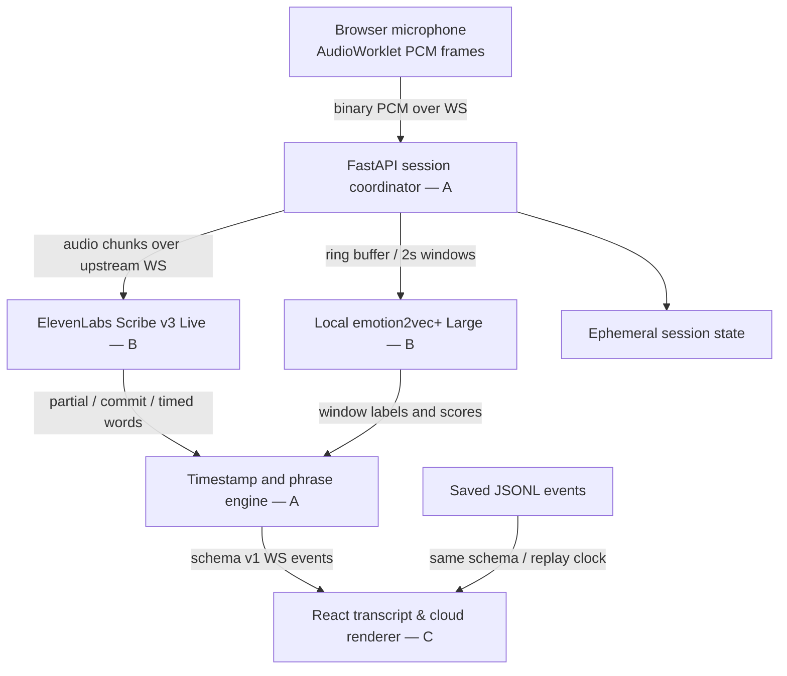

# Emotional Translator — Technical Design Document

**Version:** 1.0 (implementation baseline)  
**Date:** 2026-11-19  
**Status:** Product decisions frozen; engineering validation pending  
**Owner:** Developer A / technical lead  
**Team:** Three developers assisted by separate AI coding agents  
**Primary deliverable:** Live speech → real-time transcription → phrase-aligned vocal-emotion clouds

> **Non-negotiable:** The hackathon's central demonstration must run a *real microphone* through ElevenLabs Scribe v3 Live and a *real, locally hosted emotion2vec+ Large model*. Saved-result replay is a reproducibility mechanism and backup, not a substitute for live inference. Never describe replayed annotations as newly inferred results.

## 1. Executive summary and scope

Emotional Translator is an accessibility-oriented, single-speaker desktop web experience that displays what a person says and visually conveys **detected vocal-emotion cues**. The most recent approximately three sentences occupy the center of a dark navy interface. As speech is recognized, provisional words appear subtly and then become committed; emotion annotations arrive afterward. Organic, gently living SVG cloud shapes surround the corresponding words. Anger is red and jagged; sadness blue and round; other emotions have distinct visual signatures. The application does **not** claim to know a speaker's actual internal state, intentions, or sarcasm.

**MVP:** Browser microphone, FastAPI WebSocket audio relay, Scribe v3 Live transcription, local emotion2vec+ Large inference, timestamp synchronization, phrase annotations, animated clouds, history, session controls, text-only degradation, and offline saved-event replay.

**Post-core:** Radar for latest analyzed segment (all relevant categories), optional phrase-score inspector if time allows. **Future stretch:** speech in other languages displayed as English translations with original-audio emotion annotations. **Explicitly excluded:** emotion timeline, other emotion models, DistilRoBERTa, Qwen, openSMILE, cross-model fusion, database, remote hosting, text-to-speech, speaker identity inference, audio replay, and mandatory audio recordings.

### 1.1 Source of truth: 16 approved decisions

| # | Approved decision |
|---|---|
| 1 | Phrase-level emotion mapping with overlapping audio windows; size and saturation increase with visual intensity; opacity tracks confidence. |
| 2 | Clouds animate gently; emotion-specific silhouette (anger spiky, sadness rounded); greater confidence means greater opacity. |
| 3 | Blend two emotions only if both strongly supported; neutral speech gets **no** cloud; continuous emotional speech can use multiple coordinated clouds. |
| 4 | Transcription appears immediately, emotion follows; approximately three newest sentences centered; older text and clouds persist in scrollable history. |
| 5 | Radar deferred, showing latest analyzed segment and relevant emotion categories; phrase hover/click can inspect scores; no timeline; speech-to-English translation future stretch. |
| 6 | 2-second analysis windows with 1-second hop; balance responsiveness and stability; hardware undecided. |
| 7 | Moderate temporal smoothing; faint clouds for uncertain **non-neutral** evidence; smoothly morph changes; backend-configurable thresholds. |
| 8 | Browser audio goes to backend, which fans out to Scribe and local model; live microphone and saved-result replay; session memory only. |
| 9 | Backend owns phrase alignment; subtly show provisional words; update and finalize clouds; versioned JSON contracts/fixtures/tests. |
| 10 | A backend/orchestration, B audio/AI, C frontend; small numbered AI-agent prompts with acceptance tests; integrate each milestone; first vertical slice uses saved events. |
| 11 | One local monorepo, local frontend/backend, offline replay without keys or weights plus documented live setup, local install scripts. |
| 12 | Approximate 3-second post-phrase emotion annotation target; model failure → text-only warning; Scribe failure → retry and preserve transcript; automated contract/unit + manual live checklist. |
| 13 | Proposed distinct emotion colors/shapes; coordinated multiline clouds; gradient mixed-emotion blend; shape plus optional inspectable labels. |
| 14 | Centered dark navy transcript; start/pause/resume/stop/reset/live-replay; collapsible history below; minimal idle prompt. |
| 15 | Judges see live microphone first, replay backup; scenario-based testing; cautious vocal-cue wording; replay fixtures contain text/timestamps/scores/annotations, no audio required. |
| 16 | Scribe `commit_strategy=vad`; prioritize genuine live transcription and emotion visualization above all presentation extras. |

## 2. Grounded technical assumptions and preflight gates

1. ElevenLabs Realtime WebSocket endpoint: `wss://api.elevenlabs.io/v1/speech-to-text/realtime`; connect using `model_id=scribe_v3_live`, `audio_format=pcm_16000`, `commit_strategy=vad`, `include_timestamps=true`. Authenticate **server-side** via `xi-api-key` header. `partial_transcript` messages replace preceding provisional text; `committed_transcript` is stable; a **later** `committed_transcript_with_timestamps` provides word timing. Confirm the exact timestamp payload and ordering with a live smoke test; never fabricate timing for production annotations.
2. The emotion2vec+ Large model (`iic/emotion2vec_plus_large`, same parameter family as `emotion2vec/emotion2vec_plus_large`) has approximately 300M parameters, takes 16 kHz audio, and supports `angry`, `disgusted`, `fearful`, `happy`, `neutral`, `other`, `sad`, `surprised`, `unknown`. Official examples use `funasr.AutoModel` and `model.generate(..., granularity="utterance", extract_embedding=False)`. The model is **utterance-level**, not inherently word-level; 2-second windows are an application heuristic, not a native word classifier. The model documentation also mentions frame-level features, but **V1 only uses utterance-level classification**. A single model is used throughout.
3. Do not assume model output includes usable calibrated class probabilities without inspecting the real return value. The adapter must normalize labels and scores or fail explicitly; never synthesize probabilities from an unsupported output. Visual confidence is **relative model support**, not proof of certainty. Emotional *intensity* is a separate UI heuristic, not a measured psychological quantity.
4. Local hardware is undecided. A real-device benchmark gates live demo readiness: model load time, RAM peak, per-window p50/p95 inference, backlog under a 3-minute conversation, frontend rendering and microphone permissions. If model inference is consistently slower than hop cadence, emit fresh results as available, drop stale pending windows, never block transcription, and mark the live target unmet rather than quietly replacing the model.
5. Verify model license and distribution rights before distributing checkpoints or bundling model files. Model weights stay out of Git. Verify the ElevenLabs account has service access, enough quota, terms accepted, and a valid key.

**References (verified 2026-11-19):**
- https://huggingface.co/emotion2vec/emotion2vec_plus_large
- https://elevenlabs.io/docs/api-reference/speech-to-text/v-1-speech-to-text-realtime
- https://elevenlabs.io/docs/eleven-api/guides/how-to/speech-to-text/realtime/event-reference
- https://elevenlabs.io/docs/eleven-api/guides/how-to/speech-to-text/realtime/transcripts-and-commit-strategies

## 3. Architecture and ownership boundaries



**A owns:** FastAPI app, WebSocket boundary, audio clock, sessions, Scribe/model orchestration, phrase alignment, event schema and validation, replay delivery, integration and merge approvals. **B owns:** Scribe protocol adapter, local emotion model adapter, resampling/inference utilities, 2s/1s window scheduler, model smoke tests and performance benchmark. **C owns:** microphone browser capture adapter (its binary frame contract agreed with A), React session controls, transcript/history renderer, SVG cloud geometry, score inspector and visual tests. A owns the **backend** audio routing; C owns only browser capture. No overlapping edits to shared interfaces without approval.

### 3.1 Local runtime

- Frontend: Vite + React + TypeScript at `http://localhost:5173`.
- Backend: FastAPI + `uvicorn` at `http://127.0.0.1:8000`.
- Local WebSocket: `ws://127.0.0.1:8000/ws/v1/session` with JSON control frames and **binary** audio frames. Configure an explicit allowed local origin. Browser mic permissions on localhost; require deliberate user activation.
- Python worker: one loaded model instance per process; keep blocking inference off the asyncio event loop using a bounded executor / dedicated worker. Avoid starting multiple Uvicorn workers that would duplicate model memory.
- Default audio: mono 16-bit signed little-endian PCM, 16,000 samples/s, 20–100 ms frames. C resamples from the browser device rate in an AudioWorklet (or a verified alternative) before transmitting. Backend validates and time-indexes every frame. Do not send 48 kHz labeled as 16 kHz.
- The API key is read only from backend `.env`; never included in frontend JS, replay fixture, logs or submitted source control.
- Replay: checked-in JSONL + JSON fixtures drive the **same frontend event reducer and cloud components**, optionally served via FastAPI. Replay works with internet disconnected, no key, and no model weights.

### 3.2 Single clock and resynchronization

Use per-session `sample_offset` (integer index at 16 kHz) as the canonical audio clock. `audio_ms = sample_offset * 1000 / 16000`. Each emotion window carries start/end sample indices. Word timestamps from Scribe must be converted into that same session-relative clock. At start of each upstream Scribe connection, record the sample offset to which it corresponds; confirm whether returned timestamps are connection-relative or segment-relative in the smoke test. On reconnect start a new **audio epoch** with a recorded offset and do not retroactively shift committed words. If cross-epoch timing is ambiguous, mark that region unaligned rather than placing misleading clouds.

Maintain monotonic sequence numbers for server events, even when upstream events arrive out of order. WebSocket frames preserve ordering on a connection but separate upstream model/Scribe tasks are asynchronous. Persist no state across process restarts. Deduplicate Scribe final segments; provisional state is per-current-segment only.

## 4. Core runtime state machines

### 4.1 UI session states

`idle → connecting → listening ↔ paused → stopping → stopped`; `error` for fatal setup failures. `replay` is a separate exclusive mode (`replay_idle → replay_playing ↔ replay_paused → replay_done`). The live/replay toggle is disabled while recording: stop and reset before switching. `reset` clears transcript, annotations, pending windows, current epoch and UI history, and generates a new session ID. `stop` releases microphone and gracefully closes sockets; committed data remains visible until reset. `pause` halts capture/forwarding and starts a new audio epoch on resume if needed; timestamps must remain monotonic in **captured-audio time**. Pausing does not change old annotations. No hidden audio recording.

### 4.2 Transcript lifecycle

1. **Provisional:** `partial_transcript` replaces only current uncommitted text. Display muted and subtly animated, never assign permanent word IDs or clouds to it.
2. **Committed, awaiting timing:** On `committed_transcript`, append stable segment text **exactly once**, clear corresponding partial text, status `timing_pending`. Can display committed words without clouds; do not use guessed positions to attach annotations.
3. **Timed:** On `committed_transcript_with_timestamps`, match to waiting commit by the upstream commit ordering/segment index when supplied; otherwise by queued order plus exact or validated normalized text. Store stable `word_id`s, word start/end. If mismatch cannot be reconciled, preserve text and emit `alignment.warning` without invented alignment.
4. **Emotional draft:** When overlapping inference covers a timed phrase, emit `emotion.updated`; later windows may revise that phrase.
5. **Final:** When no future 2-second window can reasonably contribute (phrase end + window lookahead, and queued work complete or timeout), emit `emotion.finalized` to freeze it. Existing history annotations never mutate afterward. If a late result appears, discard and log a metric.

A delayed timestamp event may arrive after subsequent provisional text; it must update the correct **earlier** segment without disturbing current partial text.

## 5. Versioned wire contract

**Protocol:** `schema_version: "1.0"`; all server JSON events share envelope:

```json
{
  "schema_version": "1.0",
  "type": "transcript.partial",
  "session_id": "s-uuid",
  "seq": 12,
  "issued_at_ms": 2760,
  "payload": {}
}
```

`issued_at_ms` is monotonic **session elapsed time** for diagnostics, not a word timestamp. All audio/word/window interval fields are `start_ms` and `end_ms` on the canonical captured-audio timeline, with `0 <= start_ms < end_ms`. Arrays of words are ordered; IDs are unique and stable within a session. JSON unknown top-level types are ignored with a warning; invalid known payloads are rejected and tested. Server `seq` strictly increases for every emitted event; client reducer ignores duplicate/older `seq` in the same session. Reconnect must open a new `session_id` unless server explicitly supports stateful resumption (not in MVP).

### 5.1 Browser → backend controls

```json
{"schema_version":"1.0","type":"session.start","payload":{"mode":"live"}}
{"schema_version":"1.0","type":"session.pause","payload":{}}
{"schema_version":"1.0","type":"session.resume","payload":{}}
{"schema_version":"1.0","type":"session.stop","payload":{}}
{"schema_version":"1.0","type":"session.reset","payload":{}}
```

These are **client command** messages, not server event envelopes. Binary PCM frames are allowed only after a `session.status` state of `listening`. A successful `session.start` returns the session ID and negotiated `sample_rate_hz=16000`, `channels=1`, `sample_format="s16le"`. Reject audio sent during `paused` or `stopped`. Replay starts via local UI command / REST endpoint and must **never** open the microphone or Scribe connection.

### 5.2 Server → browser event payloads

**`session.status`**

```json
{"schema_version":"1.0","type":"session.status","session_id":"s-1","seq":1,"issued_at_ms":0,
 "payload":{"state":"listening","mode":"live","scribe":"connected","emotion_model":"ready","detail":null}}
```

Enums: `state = idle|connecting|listening|paused|stopping|stopped|error`; `scribe = disconnected|connecting|connected|reconnecting|failed|not_required`; `emotion_model = loading|ready|degraded|failed|not_required`.

**`transcript.partial`** — replace current provisional segment, not append:

```json
{"schema_version":"1.0","type":"transcript.partial","session_id":"s-1","seq":2,"issued_at_ms":500,
 "payload":{"partial_id":"p-1","text":"I thought you","language_code":"en"}}
```

**`transcript.committed`** — stable text, may lack timestamps initially:

```json
{"schema_version":"1.0","type":"transcript.committed","session_id":"s-1","seq":3,"issued_at_ms":1400,
 "payload":{"segment_id":"seg-1","text":"I thought you would call.","timing_state":"pending","language_code":null}}
```

**`transcript.timed`** — update existing segment, never append a duplicate:

```json
{"schema_version":"1.0","type":"transcript.timed","session_id":"s-1","seq":4,"issued_at_ms":1670,
 "payload":{"segment_id":"seg-1","language_code":"en","words":[
   {"word_id":"seg-1:w0","text":"I","start_ms":0,"end_ms":110},
   {"word_id":"seg-1:w1","text":"thought","start_ms":120,"end_ms":480},
   {"word_id":"seg-1:w2","text":"you","start_ms":490,"end_ms":670},
   {"word_id":"seg-1:w3","text":"would","start_ms":680,"end_ms":890},
   {"word_id":"seg-1:w4","text":"call.","start_ms":900,"end_ms":1210}
 ]}}
```

Use punctuation embedded in word `text` only as supplied by Scribe. The frontend formats whitespace by joined word spacing; do not infer timings from character offsets.

**`emotion.updated`** — backend-aligned, render-ready:

```json
{"schema_version":"1.0","type":"emotion.updated","session_id":"s-1","seq":5,"issued_at_ms":2500,
 "payload":{"annotation_id":"a-seg1-2","revision":1,"segment_id":"seg-1",
  "start_word_id":"seg-1:w2","end_word_id":"seg-1:w4","start_ms":490,"end_ms":1210,
  "state":"draft","primary":"sad","secondary":null,
  "scores":{"angry":0.07,"disgusted":0.02,"fearful":0.06,"happy":0.03,"neutral":0.09,"other":0.03,"sad":0.66,"surprised":0.03,"unknown":0.01},
  "support":0.66,"visual_intensity":0.63,"opacity":0.55,"shape":"rounded","color":"#478CD4","blend":null}}
```

`scores`: normalized, finite values in [0,1], all nine known keys, total approximately 1 when output supports probabilistic scoring; if not, adapter must document its normalized comparable score representation and mark `score_kind` in diagnostic metadata (do not silently softmax arbitrary embeddings). `support` is relative model support and might not be calibrated confidence. `visual_intensity` is a UI heuristic [0,1], `opacity` [0,1]. `shape` is an enum; `blend` either `null` or `{ "secondary": "angry", "weight": 0.4 }`. `neutral`, `other`, `unknown` must not be emitted as visible annotations; suppress them. A draft **faint** cloud may be emitted for uncertain but non-neutral support. Annotations only reference words that already exist in `transcript.timed`.

**`emotion.finalized`**

```json
{"schema_version":"1.0","type":"emotion.finalized","session_id":"s-1","seq":6,"issued_at_ms":3200,
 "payload":{"annotation_id":"a-seg1-2","revision":2}}
```

After finalization, do not accept further `emotion.updated` revisions for that annotation ID. If revised final result changes geometry, send `emotion.updated` with larger `revision` **before** the final event.

**`session.warning`**, **`session.error`** and **`session.reset`**:

```json
{"schema_version":"1.0","type":"session.warning","session_id":"s-1","seq":7,"issued_at_ms":4200,
 "payload":{"code":"EMOTION_INFERENCE_SLOW","message":"Emotion annotations are delayed; transcription continues.","recoverable":true}}
```

`session.error` uses same `{code,message,recoverable:false}` shape. `session.reset` payload `{}` empties reducer state and switches to the new session. Additional `alignment.warning` may carry `{segment_id,code,message}`; never silently forge timestamps.

### 5.3 JSON schema deliverables

The above are **normative example instances**; implement formal JSON Schema Draft 2020-12 files in `shared/schemas/v1/` for each event plus the shared envelope, word, score map and annotation structures. Generate TypeScript types from the JSON schemas or enforce a checked equivalent; Python validates with Pydantic 2. Test both languages against common good/bad examples. For cross-language stability, never change v1 fields in place: introduce an explicit `1.1` extension or v2 for breaking changes. Pin schema and fixture versions in CI.

### 5.4 Replay format

`shared/fixtures/replay_demo.jsonl`: one **complete server event envelope per line**, strictly ordered by `seq` and `issued_at_ms`. `manifest.json` includes `schema_version`, case name, fixture duration and `source="saved_result"`. Replay scheduler uses relative `issued_at_ms` offsets, not audio timestamps, can pause/resume, and does not connect to external services. Add `replay_anger_sad.jsonl`, `replay_neutral.jsonl`, `replay_mixed.jsonl`, `replay_delayed_timing.jsonl`, `replay_failures.jsonl`. Each event should follow exactly the same client reducer as live events.

## 6. Audio processing algorithm

### 6.1 Capture and segmentation

1. On user activation request microphone permission. Capture Float32 frames via AudioWorklet; downmix mono, resample properly to 16,000 Hz, quantize to signed 16-bit little-endian. Preserve continuous sample-index counting and avoid allocations per sample when possible.
2. Send frames over the local binary WebSocket after `listening`. Backend validates even byte length, queue size and frame pacing. Append to an in-memory ring buffer holding at least the most recent 8 seconds.
3. Relay PCM to Scribe in API-format `input_audio_chunk` messages with base64 audio (`audio_base_64`) using backend `xi-api-key` authorization. Establish upstream connection with `model_id=scribe_v3_live`, `commit_strategy=vad`, `include_timestamps=true`, `audio_format=pcm_16000`. Set `vad_silence_threshold_secs` via a configurable environment setting only after a smoke test (initial proposal: 0.5–0.8 s); avoid prematurely committing each word.
4. Whenever 32,000 samples have arrived and at each 16,000-sample hop thereafter, enqueue a `(start_sample,end_sample)` window. Windows: `[0,32000), [16000,48000), [32000,64000)...`. Skip mostly silent windows if a lightweight energy gate detects silence; this is **not** a second emotion model.
5. Run the **same** loaded emotion2vec+ Large model with the chosen 16-kHz 2-second PCM window, utterance granularity and embeddings off. Return normalized per-label scores with associated sample interval.
6. Keep emotion processing bounded. Only one model worker by default; `MAX_PENDING_EMOTION_WINDOWS=2` (configurable). If behind, drop oldest **not-yet-started** windows, emit metrics and preserve transcription. Never block WebSocket receive or Scribe relay on inference.
7. During pause, stop microphone forwarding. When stopping, flush any finalized Scribe messages within a bounded timeout, finalize remaining resolvable annotations, then close cleanly; no speculative words or emotion labels.

### 6.2 Scribe VAD and timestamp handling

- `partial_transcript`: replace provisional view; ignore repeated keepalives with unchanged text.
- `committed_transcript`: append one stable segment, put into pending-timestamps FIFO; explicitly **do not** assume it carries word timings.
- `committed_transcript_with_timestamps`: map to pending segment using validated ordering, align text/timestamps, and emit `transcript.timed`. Monitor drift against actual sample counts; use recording epoch offsets; log any mismatch.
- `auth_error`, `quota_exceeded` and unaccepted terms are not transient: stop reconnect attempts and visibly report setup action. `rate_limited`, network closure and transient server errors use exponential backoff with jitter (e.g. 0.5, 1, 2, 4 s max five attempts), preserve existing committed data, and mark a new upstream audio epoch. Do not replay previously sent microphone audio unless its offset and upstream behavior are proven safe.
- Silence must not clear already committed text, the current session or old clouds.

### 6.3 Scores, smoothing and classification (initial tunable heuristic)

The nine labels use exactly: `angry`, `disgusted`, `fearful`, `happy`, `neutral`, `other`, `sad`, `surprised`, `unknown`. Normalize aliases at the model boundary. Reject NaN/inf, negative or missing per-class data; if output is label-only, surface an explicit unsupported-scoring error during preflight, not fabricated scores.

For consecutive windows, apply moderate exponential smoothing independently to each label:

`smoothed_t[c] = alpha * raw_t[c] + (1 - alpha) * smoothed_(t-1)[c]`, initial `alpha = 0.55`.

Normalize to sum 1 if the source is probability-like. Initial configurable thresholds (must be calibrated, **not asserted as model-validated**):

- `NEUTRAL_SUPPRESS=0.50`: when neutral leads and exceeds threshold, render **no** cloud.
- `VISIBLE_SUPPORT=0.42`: non-neutral top score at or above threshold may render standard cloud.
- `FAINT_SUPPORT=0.25`: top non-neutral score between faint/visible thresholds renders faint cloud if neutral doesn't dominate.
- `BLEND_SECONDARY_MIN=0.30`, `BLEND_GAP_MAX=0.15`: blend second category only if it is non-neutral, passes floor, and score difference from primary is small; limit to two emotions.
- Apply 0.05–0.08 hysteresis on entering/leaving visible states to prevent flicker. In case of uncertainty between a specific emotion and neutral, prefer no cloud when neutral dominates. Unknown/other leading → no cloud.

These values are proposed **starting knobs**, not promises of classification accuracy. Evaluate and tune using test scenarios. Do not use language sentiment, text embeddings, rule-based textual sentiment or any second ML model for emotion scoring.

**Confidence vs intensity:** `support` comes from the smoothed category score (relative support). Visual intensity is an explicitly named *salience heuristic* based on the relative margin against neutral/runner-up, e.g. `clip((primary_score - max(neutral_score, runnerup_score) + 0.25)/0.75,0,1)`, then lightly smooth in time. This is *not* measured emotional intensity. The frontend may also use an optional simple RMS audio-energy contribution **only if approved and tested**, otherwise keep the pure score-derived heuristic. Do not assert that a loud voice is angry.

Opacity formula (initial): faint `0.14–0.30`, standard `0.35–0.75`, monotonic in relative support. Avoid text contrast issues. Size multiplier: `1.0 + 0.25 * visual_intensity`; saturation and deepening: bounded and monotonic with intensity. Render the actual model scores in hover inspector under the label "Model scores (not calibrated probabilities)".

### 6.4 Phrase alignment and cloud revision

- Each committed word has a canonical audio interval. Candidate phrase groups are contiguous timed words within the same commit, with breaks at punctuation, pauses > `PHRASE_GAP_MS=350` or change in dominant emotional state. Minimum phrase length ~1–2 words; avoid fragmenting every word.
- Compute temporal overlap of each word's interval with every scored 2-second window. Weight class scores by `overlap_ms / word_duration_ms` and recency/quality; avoid counting the same overlapping audio twice with total-weight normalization. Aggregate neighboring words into coherent phrases, not one cloud per word.
- Crucial limitation: a 2-second window covering several words cannot prove which individual word caused the emotion. Phrase boundaries are approximations, not word-level ground truth. In the UI, convey this as a vocal cue spanning a phrase.
- Inference may finish before `transcript.timed`; store indexed scored windows briefly and join when word timestamps arrive. Conversely, if timed words arrive before inference, render plain words until annotation ready.
- `emotion.updated` with the same `annotation_id` and increasing `revision` morphs visuals while draft; aim to freeze when all covering windows are processed or after configured bounded lookahead/timeout (initial 2 s after phrase end, **measured from completed audio**, plus scheduling delays). Emit `emotion.finalized` once. No subsequent alterations to finalized history.
- Extended single-emotion spans break into several geometry units at visual line wraps but retain one coherent region ID; multiple clouds across lines should visually coordinate. Layout-wrapped geometry belongs to C, **classification/span grouping belongs to A**.
- Phrase finalization does **not** wait forever for a missing model window; timeout results in no cloud or the best defensible draft, with an explicit quality flag in logs.

### 6.5 Latency metrics

Measure `phrase_end_audio_ms → first_cloud_display_wall_time` by pairing session capture time with wall-clock milestones. Track microphone→partial p50/p95, phrase-end→timestamp availability p50/p95, inference queue wait, inference duration p50/p95 and phrase-end→cloud p50/p95. **Goal:** approximately 3 s after relevant speech ends; record actual figures and qualify whether target was met. Long continuous speech may postpone VAD commits and therefore clouds; this is an accepted risk requiring live testing, not a reason to invent word timestamps.

## 7. Frontend specification

### 7.1 Layout

- Desktop-first, responsive at 1280×720 and 1440×900; usable at narrower widths but desktop judging prioritized.
- Dark navy base `#101827` / panel `#192438`; off-white high-contrast text. Approximately three most recent completed or currently spoken sentences occupy central, visually dominant region. Current partial in subdued lighter/muted treatment and visually distinct from committed words.
- Header: app name, `LIVE`/`REPLAY` mode indicator and connection/status. On first load show microphone icon, single-sentence prompt ("Start listening to see vocal emotion cues"), and start button.
- Bottom controls: Start, Pause/Resume, Stop, Reset, Live/Replay. Disable impossible actions according to state machine; explicit status for `connecting`, `reconnecting`, `model degraded` and `stopped`.
- Older committed sentences move into **collapsible scrollable transcript history below**. Preserve every cloud annotation and its eventual finalized geometry across movement. Do not throw away data when text leaves center. One user action may expand history; automatic scrolling should not steal focus while history is being read.
- Hover/focus/click an annotated phrase: show category, approximate model support, all nine scores and uncertainty caveat in a small accessible inspector. For touch, click/tap. Radar is explicitly not a core dependency.

### 7.2 Emotion visual tokens

| Model category | Color | Geometry | Display |
|---|---|---|---|
| angry | `#DC4545` | Sharp irregular spikes | Red jagged cloud |
| sad | `#478CD4` | Rounded, drooping lobes | Blue rounded cloud |
| happy | `#EDB94B` | Buoyant radial soft lobes | Golden cloud |
| fearful | `#9975D8` | Uneven slightly trembling perimeter | Purple cloud |
| surprised | `#EF9858` | Short expanded burst | Orange cloud |
| disgusted | `#68A876` | Asymmetric wavy outline | Green cloud |
| neutral | none | none | No cloud |
| other, unknown | none | none | No category-specific cloud |

Use vector SVG procedural paths, not a static raster background. Text sits above the cloud layers; no cloud may obstruct reading. When two strong non-neutral emotions coexist, interpolate between the two colors using an SVG gradient and blend silhouette parameters; **never** suggest colors correspond to two different speakers. Make shape silhouette distinct even for color-vision differences. Faint uncertain non-neutral predictions remain very subtle, but neutral remains entirely unannotated.

### 7.3 SVG positioning across text wraps

Use stable per-word `<span data-word-id>` nodes inside a phrase wrapper. On layout/resize, measure per-word text bounding rectangles (`Range.getClientRects()` or equivalent) and group consecutive rectangles into line runs. Generate organic cloud SVG background geometry behind each run, with small overlaps/connecting shapes where appropriate, maintaining coordinated appearance across lines. Re-measure on resize/font changes/center→history transitions; throttle via ResizeObserver/requestAnimationFrame in actual source code. Stable `annotation_id` serves as key to avoid abrupt recreation. Never position cloud from raw character offsets. Avoid `filter: blur()` severe enough to lower text contrast. Test extremely long phrases, punctuation, resize, overlapping emotions and history movement.

Animations: gentle low-amplitude morph/breathing (e.g. 2–4 s), animated color/geometry transitions ~250–450 ms, intensity changes smooth, never seizure-like flashing. Respect `prefers-reduced-motion`: transitions become brief non-looping fades, with shape/color semantics preserved. Optional tooltip label not always visible. Cloud layers `pointer-events: none`; word elements handle hover/focus/click and keyboard focus.

### 7.4 React state

One reducer consumes identical `ServerEventV1` shapes from live WebSocket or replay scheduler. Store `session`, ordered `segments`, map of words by ID, provisional text, annotations by ID, finalized annotation IDs, connection warnings and UI view state. Rendering selectors return current ~3 sentences vs history; they must never mutate stored annotations. Reject stale revisions and events from prior sessions. Full UI state tests with fixtures.

## 8. Project tree and setup

```text
emotional-translator/
  README.md
  .gitignore
  .env.example
  package.json                      # optional root convenience scripts
  backend/
    pyproject.toml
    requirements.lock               # or validated pinned requirements
    app/
      main.py                       # FastAPI composition / health endpoint
      ws.py                         # WS client protocol and state transitions
      config.py
      session.py                    # audio epochs, status and event sequence
      audio/clock.py
      audio/relay.py                # B adapter wired by A
      audio/window_scheduler.py     # B
      adapters/scribe.py            # B
      adapters/emotion2vec.py       # B
      emotion/smoothing.py          # B
      alignment/segments.py         # A
      alignment/phrases.py          # A
      schemas.py                    # generated/validated models
      replay.py                     # A
    tests/
  frontend/
    package.json
    src/
      app/App.tsx
      audio/capture.ts              # C, interface frozen with A
      protocol/events.ts            # schema-derived types
      state/reducer.ts
      components/Transcript.tsx
      components/CloudLayer.tsx
      components/TranscriptHistory.tsx
      components/SessionControls.tsx
      components/EmotionInspector.tsx
      styles/tokens.css
    tests/
  shared/
    schemas/v1/
    fixtures/replay_demo.jsonl
    fixtures/replay_*.jsonl
    fixtures/manifest.json
    fixtures/invalid/
  scripts/
    setup.sh
    start_backend.sh
    start_frontend.sh
    smoke_scribe.py
    benchmark_emotion.py
    verify_replay.sh
  docs/
    TDD.md
    DECISIONS.md
    HANDOFFS.md
    prompts/A-01.md ...
    prompts/B-01.md ...
    prompts/C-01.md ...
```

`.env.example` (no actual secrets):

```dotenv
ELEVENLABS_API_KEY=
SCRIBE_MODEL_ID=scribe_v3_live
SCRIBE_COMMIT_STRATEGY=vad
SCRIBE_VAD_SILENCE_SECS=0.65
AUDIO_SAMPLE_RATE=16000
EMOTION_MODEL_ID=iic/emotion2vec_plus_large
EMOTION_WINDOW_SECONDS=2.0
EMOTION_HOP_SECONDS=1.0
EMOTION_SMOOTHING_ALPHA=0.55
EMOTION_VISIBLE_SUPPORT=0.42
EMOTION_FAINT_SUPPORT=0.25
EMOTION_NEUTRAL_SUPPRESS=0.50
EMOTION_BLEND_SECONDARY_MIN=0.30
EMOTION_BLEND_GAP_MAX=0.15
MAX_PENDING_EMOTION_WINDOWS=2
```

These are initial proposed configuration values; validate before claiming performance. `setup.sh` checks Python/Node versions, builds Python venv, installs pinned dependencies and frontend packages. `start_backend.sh` runs one Uvicorn worker. `start_frontend.sh` runs Vite. `verify_replay.sh` runs schema tests plus a smoke check in keyless replay mode. Document how to download model weights in a separately invoked live preflight command; replay setup must **not** automatically download them.

**Security and privacy:** mic capture only after explicit click, visual live indicator, browser→local WebSocket only, API key kept in backend environment, ephemeral audio ring buffer and transcript history, no database, no default WAV recording, no transcription contents in normal logs, reset clears memory. Scribe's cloud service receives live audio and its service-side retention is governed by account settings and provider policy; don't promise entirely on-device processing. Avoid implying an accessibility or clinical validation that hasn't been conducted.

## 9. Developer handoffs, git policy, and milestone plan

**Branch strategy:** protected `main`, `dev/a-*`, `dev/b-*`, `dev/c-*` topic branches. A maintains `docs/DECISIONS.md`, schemas and integration app. Each PR references its milestone, changed files, acceptance-test output and any unresolved assumptions. No AI coding agent edits another person's files unless A explicitly coordinates. Merge smallest passing pieces, one at a time, with A approving schema changes. Freeze schema v1 before parallel implementation; mocks allow B and C to work without live dependencies.

### Milestones (small prompts, not single mega-prompts)

| Stage | A: orchestration/backend | B: audio & AI | C: frontend | Integration gate |
|---|---|---|---|---|
| 0 Foundation | A-01 repo, schemas, fixture envelopes, Python test harness | B-01 model/output preflight script; independent branch | C-01 Vite skeleton and wire types | Both languages validate shared fixtures |
| 1 Vertical slice | A-02 replay endpoint/stream and session sequence | B-02 fake emotion adapter producing only contract data | C-02 reducer + centered transcript + basic clouds/history | Offline fixture → animated cloud UI, no keys |
| 2 Real adapters | A-03 WebSocket capture clock/relay orchestration | B-03 Scribe v3 Live VAD + timestamp smoke; B-04 emotion2vec+ load/window inference | C-03 AudioWorklet PCM and session controls | Mic→live provisional text; real model window scores |
| 3 End-to-end | A-04 pending commits, timed words, phrase alignment | B-05 smoothing/hysteresis + bounded worker | C-04 SVG multiline geometry, fading, morph, inspector | Live mic→proper phrase clouds and tests |
| 4 Hardening | A-05 reconnect, epochs, error behavior, finalization | B-06 latency/quality benchmark and configuration | C-05 responsive polish, reduced motion, history | Three-minute live test; replay with no key |
| 5 Submission | A-06 README/demo guide, merge and final verification | B-07 reproducibility/model caveats | C-06 screenshots/demo polish after live reliability | Judge demo live-first, replay fallback |

**First vertical slice acceptance:** with no internet, no API key and no model weights, developer A starts backend and C starts frontend; choosing Replay plays a checked-in saved transcript with timed phrases and animated emotion clouds; neutral has none; multiline layout, history, and revision/finalization work; schema tests pass. This is a **development milestone**, not the finished MVP.

**AI-agent prompt template (use for every A/B/C numbered prompt):** identify milestone and owner; provide goal, exact allowed files, read-only dependencies, schema references, supplied fixture example, constraints and non-goals, implementation tasks, unit/contract tests, manual verification commands, expected output, commit instructions and a short handoff note. Require agents to inspect existing code before editing; ban invented endpoint fields, second models and interface changes without approval. Finish each milestone with `tests passed / tests blocked / assumptions / changed files`.

## 10. Errors, recoverability and user experience

| Failure | Backend behavior | Frontend behavior | Data preserved? |
|---|---|---|---|
| Mic denied | Reject start, no socket forwarding | Permission instructions and retry | Yes |
| Invalid/non-16k audio | Drop bad chunk, report invalid format, may end session | Input warning | Prior events |
| Scribe network dropped | Mark reconnecting, bounded exponential backoff, new epoch | Show reconnect banner; avoid new provisional guess | Committed transcript/clouds |
| Scribe auth/quota/terms | Stop retry; explicit reason, cannot transcribe | Clear actionable error, enable Replay | Prior session |
| Scribe timestamps delayed | Keep pending commit text, buffer emotion windows | Committed text remains without cloud | Yes |
| Scribe timestamps absent/mismatch | Emit alignment warning; skip unsupported phrase clouds | Plain text rather than misleading annotation | Yes |
| Model fails/too slow | Do not block STT; drop stale tasks, status `degraded` | Text-only with small warning | Committed text/previous clouds |
| No audible speech | Maintain connection/idle state | Listening indicator, no clouds | Yes |
| Replay malformed | Validate and stop replay without starting live services | Show fixture error | No corrupted app state |
| User stops/resets | Cancel tasks, close sockets, clear on reset | Correct enabled controls | Stop: yes; Reset: no |

On malformed annotation references, frontend ignores the bad annotation and logs a developer warning. It must never crash or attach a cloud to arbitrary text. Network retries must not reuse the last provisional words as committed words.

## 11. Tests and acceptance criteria

### 11.1 Automated contracts and unit tests

- **Schema:** valid event fixtures pass in Python/TypeScript; absent envelope fields, invalid enums, missing scores, reversed timestamps, NaNs, duplicate IDs and stale revisions are rejected.
- **Audio:** Float32→PCM16 conversion, mono downmix, accurate sample count, ring-buffer window boundaries `[0,2],[1,3],[2,4]` s, bounded backlog, pause/resume clock behavior.
- **Scribe:** partial replacement rather than concatenation; commit once; delayed timed event updates correct prior segment even with a new partial; repeated keepalives ignored; no fake timestamps; reconnection epochs preserve prior text.
- **Model:** the actual adapter loads specified Large model, normalizes real output labels, rejects missing scores, reports performance; no stub code in live mode.
- **Smoothing:** score vectors normalized, no neutral cloud, faint non-neutral uncertain cloud, adjacent fluctuations smoothed, blend at most two sufficiently supported classes, monotonic opacity/intensity visuals.
- **Alignment:** overlap weighting, punctuation/pause boundaries, delayed inference and timestamp ordering, phrase revision and freeze, no off-by-one word ID references.
- **Frontend:** event reducer identical for live/replay; partial→commit→timed transition; old history retains annotation IDs; reduced motion; no overlapping clouds obscuring words; UI commands disabled in invalid states.
- **Replay:** runs without internet/API key/model weights; deterministic event order; fixture `source=saved_result` displayed in mode label; replay never opens microphone.

### 11.2 Manual scenario matrix

| Scenario | Expected visible result |
|---|---|
| Neutral conversational sentence | Rapid provisional/committed text; no cloud |
| Clearly angry vocal delivery | Jagged red phrase cloud when supported by model |
| Soft sad delivery | Rounded blue phrase cloud when supported |
| Joyful delivery | Golden distinct cloud when supported |
| Anger→sadness transition | Gradual change in shape/color; annotation does not jump words |
| Mixed emotion (if model genuinely supports two) | Two-color gradient; never fabricate mixture merely for demo |
| Long continuous speech | Words continue appearing; document possible VAD timestamp delay |
| Long emotional passage wrapping lines | Multiple coordinated clouds spanning lines, readable text |
| Uncertain non-neutral detection | Faint cloud with accessible score caveat |
| Model backend slow/fails | Transcription continues, warning shown, existing transcript preserved |
| Scribe disconnected then returns | Banner and reconnection; historical text preserved; no duplicate segments |
| Offline Replay | Same renderer demonstrates entire saved fixture with no services |
| Stop/reset/pause | Correct state changes and no phantom audio processing |

Use scripted spoken examples with actual variation in vocal delivery; compare observed model predictions with human expectations qualitatively without presenting this as a validated emotion-recognition benchmark. A script's intended emotion does **not** automatically become the model result. Record actual failures.

### 11.3 Release gates

**G0 — Contracts:** schemas, generated types, replay fixtures, and validation tests approved by A.  
**G1 — Replay vertical slice:** complete visible experience using saved JSONL events, offline and no key.  
**G2 — Real Scribe:** actual microphone partial+committed words with timestamp mapping; at least 2 minutes without duplicate words.  
**G3 — Real model:** emotion2vec+ Large loaded and returning inspected nine-category scores on target hardware; 2s windows / 1s hop benchmark recorded.  
**G4 — End-to-end:** real microphone produces corresponding phrase clouds; no model stubs, manually verified on at least three emotional scenarios and a neutral one.  
**G5 — Failure resilience:** model failure text-only, Scribe reconnect preserves text, malformed events don't crash UI.  
**G6 — Submission:** README with setup, exact hardware/software environment, video or live demonstration instructions, replay provenance, documented measured latency and known limitations.

**Strict definition of done for the centerpiece:** spoken microphone audio actually reaches Scribe **and** emotion2vec+ Large, returns timestamped transcript and scored windows, and creates dynamically aligned cloud annotations. Successful replay alone does **not** satisfy the MVP. Target phrase-end→cloud latency is approximately 3 s, but any miss must be measured and documented, not hidden.

## 12. Judge presentation runbook

1. Before judge arrives: backend running, emotion model preloaded, local frontend open; verify mic, API quota and Wi-Fi. Keep Replay fixture ready, but mode must visibly read `LIVE`.
2. Give single-sentence explanation: "This tool turns detected vocal tone into visual cues alongside live speech, to make those cues easier to notice."
3. Press Start. Speak a short neutral phrase, then a distinctly angry phrase, then sad and happy phrases, with natural pauses for Scribe VAD. Point out immediate provisional text and later phrase-aligned clouds; demonstrate shape/size/color/opacity interpretation. Do not claim exact feelings or guaranteed detection.
4. Show history preserves previous annotations and hover an emotional phrase for labeled model scores.
5. If live fails, explain the failure clearly and switch to labeled `REPLAY` mode showing the same visual architecture on saved output; do not imply the replay is live.
6. Mention limits: short windows are heuristics, model predictions are imperfect and may be affected by voice/accent/noise, and live transcription audio travels to ElevenLabs while emotion inference runs locally.

## 13. Stretch features and future-compatible fields

**Emotion radar (after G4 only):** small upper-left radar of latest analyzed segment, all relevant supported categories, synced to hover/click without changing core classification pipeline. No timeline.

**Multilingual English transcript (after G4 only):** Add optional `original_language`, `original_words`, `translated_text`, and translation-alignment segments; preserve original audio timestamps and infer emotion solely on original audio. Spoken language may differ from English, with a separate explicit translation component not implemented in V1. Do not assume a word-to-word correspondence in translation; map by phrase interval. Scribe's multilingual transcription capability is not itself English translation. Version the contract when introducing fields; never silently relabel translated words as original timestamped words.

**Avoid:** adding another emotion inference model, textual sentiment scoring, audio-driven TTS, a sentiment timeline, speaker emotion diagnoses or remote deployment before live quality is acceptable.

## 14. Open engineering tasks (not unresolved product decisions)

- [ ] Choose and record actual judging laptop, OS, available RAM/CPU/GPU and Python version.
- [ ] Confirm approved Scribe v3 Live quota/terms and provider's real timestamp payload through an instrumented smoke test.
- [ ] Inspect actual FunASR model `generate()` return schema, score normalization and memory footprint; pin working library versions.
- [ ] Benchmark 2-second utterance windows with a 1-second hop and measure actual phrase-end-to-cloud latency.
- [ ] Tune VAD silence threshold and emotion smoothing/blend thresholds using demo scenarios.
- [ ] Validate service-provider retention expectations and permissions before recording anyone else.
- [ ] Finalize implementation commit hashes, README commands and demo fallback contingency.

**Status:** Product TDD is implementation-ready as a baseline. G2/G3 are **real-world integration validation gates**, not blockers to beginning the shared-contract/replay vertical slice. If they expose a conflict with the approved architecture, escalate to Developer A and update this TDD through a documented decision rather than silently changing the product.
